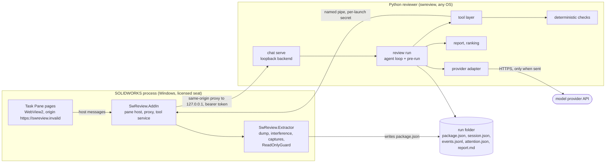

# Architecture overview

What smart_SW is made of and how data moves through it, for a newcomer engineer or a
developer in a company that forks it. It is a map, not a specification: each section links
to the spec or contract that is authoritative for the detail. Terms in this page are defined
in the [glossary](glossary.md).

## 1. Purpose and the core principle

smart_SW reviews SOLIDWORKS designs. It reads an assembly, part or drawing, runs
deterministic engineering checks over what it read, asks a language model to investigate and
explain, and writes a findings report an engineer can verify and disposition
([constitution](../.specify/memory/constitution.md), opening paragraph; [AGENTS.md](../AGENTS.md)).

The rule every component is shaped by is Principle II of the constitution, "Deterministic
Numerics, Agentic Investigation": every number - a measurement, a unit conversion, an
interference, a fit or a stack - comes from checked, tested code. The model may decide what to
investigate, ask for evidence, interpret results and explain them; it must not do the
arithmetic that produces a verdict. Principle I adds that every finding carries its evidence,
and that a missing input stays unknown rather than being filled with a favourable guess.

The split of work follows from that, and from the hybrid option C of
[ADR 0001](adr/0001-agentic-review-architecture.md): SOLIDWORKS does only what SOLIDWORKS can
do (read feature and mate semantics, run interference detection, capture views), and the
reasoning runs in Python on an intermediate representation (IR) that can be replayed and tested
without a CAD seat.

## 2. Components and boundaries

### The C# half: `extractor/`

The only tree that calls the SOLIDWORKS API ([extractor/README.md](../extractor/README.md)).
It targets SOLIDWORKS 2024 and .NET Framework 4.8 x64.

| Project | What it is |
|---|---|
| `SwReview.Extractor` | Class library: the IR dump (`Dump/`), interference (`Interference/`), captures (`Capture/`), measurement (`Measure/`), mesh export (`Mesh/`), persistent references (`PersistRefs/`), the bridge dispatcher (`Bridge/`), and the guards (`Guard/`: `ReadOnlyGuard`, `CircuitBreaker`, `DrawingOpenGuard`, `SuppressTestGuard`, `RemodelGuard`, `RemodelProbeGuard`). |
| `SwReview.Extractor.Console` | Out-of-process host with the commands `dump`, `resolve`, `interference`, `capture`, `serve`, `probe` and `suppress-test` (`Program.cs`). `serve` speaks the pipe protocol in [Serve/PROTOCOL.md](../extractor/SwReview.Extractor.Console/Serve/PROTOCOL.md). |
| `SwReview.AddIn` | The in-process add-in: the Task Pane, the in-process tool service (`ToolService/`), the backend child process and proxy (`Review/`), the per-user settings (`Settings/`), and one host per tab (`Review/`, `Model/`, `Standards/`, `Remodel/`). |
| `SwReview.*.Tests` | xUnit tests for both projects. |

**The Task Pane** (`TaskPaneControl.cs`) shows five tabs: **Review**, **Extract**, **Model
check**, **Remodel** and **Standards**. A sixth, **Ask** (an external command-line assistant
in a pseudo-console), is built but hidden (`AskTabShown = false`). Each WebView2 tab loads a
page from the add-in's own folder (`Review/ReviewPage`, `Model/ModelCheckPage`,
`Standards/StandardsPage`, `Remodel/RemodelPage`, with shared files in `web/shared`). Pages
talk to their host through the messages in
[pane-host-messages.md](../specs/002-task-pane-assistant/contracts/pane-host-messages.md).

**The local backend and the same-origin proxy.** The add-in starts `swreview chat serve` as a
child process (`Review/BackendProcess.cs`, found by `Review/BackendLocator.cs`), which binds
`127.0.0.1` on a free port and prints one handshake line with the port and a bearer token
([chat-api.md](../specs/002-task-pane-assistant/contracts/chat-api.md)). The pages never call
loopback themselves: they are served from the virtual origin `https://swreview.invalid`, and the
host answers both the page files and every `/__backend` request through WebView2's
`WebResourceRequested`, forwarding the latter to the backend from C#. This keeps the pane on
one origin with no CORS, and it is why a corporate web filter that intercepts browser traffic to
loopback cannot break it ([pane-backend-proxy.md](pane-backend-proxy.md)).

**The tool service** (`ToolService/`) lets the Python side ask the running SOLIDWORKS for the
few things only it can do - capture, measure, interference, tessellate, read a drawing - over a
named pipe, with a per-launch secret and a fixed command allowlist
([bridge PROTOCOL.md](../reviewer/src/swreview/bridge/PROTOCOL.md)). Every call runs on the
application thread through the read-only guard.

### The Python half: `reviewer/src/swreview/`

Python 3.11 or later, run with `uv`. It needs no SOLIDWORKS licence, so it runs in CI and on any
machine (constitution, Technical Constraints).

| Package or module | Role |
|---|---|
| `cli.py` | The `swreview` command: `validate`, `ingest`, `review`, `report`, `disposition`, `timing`, `attention`, `handoff`, `audit-secrets`, `mcp`, and the groups `check`, `benchmark`, `exceptions`, `chat`, `rms`, `remodel`, `tokenizer`, `drawing`, `profile`, `context` ([001 cli.md](../specs/001-agentic-design-review/contracts/cli.md) and each feature's `contracts/cli.md`). |
| `ir/` | The typed, versioned IR (pydantic models, loader, JSON Schema export). A package whose major `schema_version` is unsupported is refused. |
| `ingest/` | Builds a `package.json` from exported files (BOM, PDF drawings, manifest) instead of a SOLIDWORKS dump. |
| `checks/` | The deterministic checks: interference, fit, stack, fastener and thread engagement, hole and joint alignment, tolerances, tool access, mass and material, hygiene, part roles, drawing context; the rule families `checks/rms/` (Resilient Modeling) and `checks/standards/` (release standards) over the shared machinery in `checks/rules/`. |
| `geometry/`, `units.py` | Pure geometry helpers in metres, and the one unit conversion module. |
| `tools/` | The curated tools the model may call (`registry.py`): package queries, measurements, check entry points, evidence requests, the bridge tools. No generic code execution tool exists, as the constitution requires. |
| `prerun.py` | **Checks first**: runs the self-enumerating checks through the same tool dispatch before the model's first turn and writes the digest the model opens with. |
| `agent/` | The review loop (`runner.py`), the event sink (`events.py`), the system prompt and checklist (`prompts/system_v1.md`, `checklist_v1.yaml`), the package brief, the settings and levers (`settings.py`), and the provider adapters (`providers/`). |
| `agent/providers/` | One adapter per provider behind one protocol: `openai_provider.py` (in use), `gemini_provider.py` (present; Gemini work is deferred by owner decision 94A, [014 research](../specs/014-design-review-eval/research.md)), `fake.py` (scripted, for tests and development builds), `deferred.py` (stands in while a review waits for Send). |
| `report/` | The session record, `report.md` rendering, the attention ranking and `attention.json`, dispositions, plain-language words (`review_words_v1.yaml`). |
| `chat/` | The loopback backend the pane talks to (`server.py`, Starlette and uvicorn), with the Remodel routes (`remodel.py`) and the engineering-context routes (`engineering_context.py`). |
| `bridge/` | Clients for the tool-service pipe (`client.py`) and the remodel commands (`remodel_client.py`). |
| `drawings/` | Native drawing evidence as the checks read it (feature 011). |
| `remodel/` | The Resilient Modeling re-modeler's plan, executor, geometry comparison, source attestation and report (feature 004). |
| `engineering_context/` | Engineer-entered requirements and applied forces, stored as immutable, confirmed revisions (feature 016). |
| `benchmark/` | The evaluation harness: runs over fictional packages, scoring against answer keys, replay, studies, comparison, the cost table (`prices.yaml`). |
| `mcp/` | A read-only MCP tool server for the hidden Ask tab. |
| `secrets.py`, `handoff.py`, `tokens.py` | The secrets audit, the local handoff ZIP export, and the pinned tokenizer. |

### The evidence package

The **evidence package** is a run folder's `package.json` (plus `meshes/` and `captures/`): the
IR of one design as extracted. Its root is `EvidencePackage` - manifest, design, documents,
components, mates, holes, threads, fasteners, faces, bodies, interferences, captures, drawings
and `gaps` - and every entity carries a persistent reference so a finding can point back to the
exact SOLIDWORKS entity. A value that could not be read is `null` with its reason in `gaps`,
never defaulted. Normative: [001 data-model.md](../specs/001-agentic-design-review/data-model.md)
section 2 and [ir.schema.json](../specs/001-agentic-design-review/contracts/ir.schema.json).

### The evaluation harness

`swreview benchmark` runs reviews over the committed fictional cases in
[benchmarks/](../benchmarks/README.md) (packages, answer keys, scripted answers, sets), scores
them, replays recorded sessions offline, and compares the arms of a study into the ledger in
[llm-efficiency-options.md](llm-efficiency-options.md). Contracts:
[005 ab-harness.md](../specs/005-llm-efficiency/contracts/ab-harness.md),
[008 replay.md](../specs/008-checks-first-review/contracts/replay.md) and
[014 contracts](../specs/014-design-review-eval/contracts/README.md).

## 3. One review, end to end

From the engineer pressing **Review** to the findings report. Message and route names are from
[pane-host-messages.md](../specs/002-task-pane-assistant/contracts/pane-host-messages.md) and
[chat-api.md](../specs/002-task-pane-assistant/contracts/chat-api.md); the Send gate is
[015 review-flow.md](../specs/015-review-send-gate/contracts/review-flow.md).

1. **Prepare.** The Review page sends `review.prepare`; the host reads the active component tree
   without writing anything or contacting a model and answers with the component count and any
   unread (for example lightweight) instances.
2. **Extract.** The page sends `review.start`. The host creates the run folder
   `<run_root>/<yyyyMMdd-HHmmss>-<doc>` (`Review/RunFolders.cs`) and runs the in-process dump
   through the read-only guard, which writes `package.json`.
3. **Start the session.** The host calls `POST /sessions` with the run folder, provider, model,
   effort, the tool-service pipe and secret, the standards profile path and
   `send_when_checked`. The backend refuses a folder outside its run root.
4. **Code checks.** The backend loads and validates the package, closes provenance, classifies
   part roles and, under the pane's defaults, runs **checks first**: the checks that enumerate
   their own scope (for example the RMS rules, every interference group with live detection when
   SOLIDWORKS is attached, and the standards checks when a profile is set) run through the same
   tool dispatch the model uses, so each is a recorded step with its findings and coverage
   ([008 checks-first.md](../specs/008-checks-first-review/contracts/checks-first.md)). Every
   event is appended to `events.jsonl` and streamed to the page as server-sent events
   (`GET /sessions/{chat_id}/events`).
5. **The send gate.** With "Send to the model when the checks finish" unticked, the review stops
   here in `awaiting_send`: nothing has reached a provider, no key was needed, and the page shows
   the estimated size of the first request beside a Send button
   (`POST /sessions/{chat_id}/send`). Ticked (the default), or after Send, the review continues.
6. **The model investigates.** The first request carries the system prompt and checklist, the
   package brief and the checks-first digest, and the tool definitions. The model calls tools;
   each tool runs tested code and records its own findings and coverage; the model may ask the
   engineer questions as evidence requests. A non-numeric drawing finding the model records
   itself can only be `suspected` or `unresolved`
   ([agent-tools.md](../specs/001-agentic-design-review/contracts/agent-tools.md)).
7. **Finalize.** Open requests and checklist items become `unresolved` coverage, and the run
   writes `session.json` (the session: steps, findings, evidence requests, coverage, timing,
   token usage) and `attention.json` (the order the findings were ranked in). The CLI and the
   backend render `report.md` from the session
   ([review-session.schema.json](../specs/001-agentic-design-review/contracts/review-session.schema.json),
   [007 attention.md](../specs/007-attention-policy-gate/contracts/attention.md)).
8. **The engineer works the findings.** Answers to questions (`POST .../evidence`) resume the
   review; Accept, Reject or Defer (`POST .../disposition`) is recorded on the finding and
   re-renders `report.md`. A finished review can be reopened read-only later
   (`GET /reviews/{run_id}`).

Other files a run folder may hold: `exceptions.json` (waivers carried forward, read when
present), `engineering-context-summary.json` (when a saved engineering context is attached),
`check.json` (a Model check or Standards run), and the Remodel files of
[004 run-artifacts.md](../specs/004-resilient-remodeler/contracts/run-artifacts.md). The command
line runs the same review without SOLIDWORKS: `swreview review <package-dir> --out <dir>`.

## 4. Trust and security boundaries

**SOLIDWORKS documents are read, not written.** The constitution's Technical Constraints make
every check, tool and add-in command treat open documents as read-only, enforced by
`ReadOnlyGuard`, whose denylist grows whenever a phase touches an API family that can write.
There are exactly two exceptions, each bounded in the constitution itself:

1. the **suppressibility test** of feature 003: console-only, behind an explicit flag, under a
   guard that exempts exactly two members, with a whole-tree snapshot and a verified restore,
   never saving;
2. the **re-modeler** of feature 004, which may create and modify exactly one document: a copy
   it made itself in the run folder before any SOLIDWORKS handle existed. The engineer's file is
   never opened for writing; its size, time and hash are attested before and after. Writes go
   through an allowlisting, document-scoped guard; the model proposes intent and a deterministic
   executor applies it. The result is a proposal the engineer accepts or discards.

A third exception needs a constitution amendment. Separately, feature 011 opens a drawing the
engineer confirmed, read-only, through `DrawingOpenGuard`
([011 confirmed-open.md](../specs/011-drawing-context/contracts/confirmed-open.md),
[guard.md](../specs/011-drawing-context/contracts/guard.md)).

**Keys.** A provider key is never written as text to a file, a command line or a log
([AGENTS.md](../AGENTS.md) rule 3). The add-in stores it DPAPI-protected for the current Windows
user in the per-user settings file and decrypts it only into the backend child's environment
(`Settings/UserSettings.cs`); the backend reads credentials from its environment only and
redacts them from every error body ([chat-api.md](../specs/002-task-pane-assistant/contracts/chat-api.md)).
The command line reads `OPENAI_API_KEY` from the environment. `swreview audit-secrets` searches
files for the configured key and for key-shaped strings, and CI runs it over everything the
tests wrote (`secrets.py`, `.github/workflows/reviewer.yml`).

**What leaves the machine.** In normal use, only the provider call from the backend. It is made
only when the review is sent: unticked, nothing about the review reaches a provider until Send
([015 spec](../specs/015-review-send-gate/spec.md), decision 59A). The model is sent the system
prompt, the checklist, the package brief and digest, the tool definitions, the tool results it
asks for (with persistent references stripped when payload slimming is on,
[008 model-view.md](../specs/008-checks-first-review/contracts/model-view.md)), the engineer's
messages and answers, and a bounded projection of any attached engineering context. The Model
check and Standards tabs send nothing off the machine: they construct no provider and read no
key, and their only connection is the pane's own, through the same-origin proxy to the loopback
backend on `127.0.0.1`. One other command reaches the network:
`swreview tokenizer fetch` downloads the pinned tokenizer vocabulary once into a per-user cache
([008 tokenizer.md](../specs/008-checks-first-review/contracts/tokenizer.md)). `swreview handoff`
writes a local ZIP that keeps design paths; it is not sent anywhere.

**The pane's own boundaries.** The backend binds `127.0.0.1` only, requires the bearer token on
every request, and accepts a `run_dir` only strictly inside its run root. The pane cancels any
navigation off its own origin, so a link in model-written text cannot navigate it
(`TaskPaneControl.cs`). The tool-service pipe needs the per-launch secret and accepts only its
allowlisted commands.

**What the repository may hold.** The repository is public and holds fictional data only
([AGENTS.md](../AGENTS.md) rule 2; the full list of what that excludes is
[the public-repository rule](../CONTRIBUTING.md#the-public-repository-rule)). Everything real
stays on the machine, outside the checkout:

| Location | Holds |
|---|---|
| `%APPDATA%\SwReview\settings.json` | Per-user pane settings and the DPAPI-protected key |
| `%LOCALAPPDATA%\SwReview\` | The standards profile (default path), logs, the tokenizer cache, and private evaluation material |
| The run root (default `Documents\SwReview\runs`) | Run folders, which hold extracted design data and reports, and the private engineering-context stores under `.engineering-context\` |

## 5. Extension points

What a downstream fork can change without editing code, and the file that defines each.

| Extension point | How | Defined in |
|---|---|---|
| Standards profile (the company's release rules, library prefixes, part numbering, drawing rules, part roles) | A YAML file outside the repository; start from the fictional example. Pane: `standards_profile_path` setting. CLI: `--profile` on `check standards` and `drawing brief`, `--standards-profile` on `review`, `benchmark run` and `benchmark replay`. `swreview profile upgrade` writes a proposed version 4 profile from a version 3 one. | [config/standards.example.yaml](../config/standards.example.yaml), [006 profile.md](../specs/006-standards-check/contracts/profile.md), `checks/standards/profile.py` |
| Pane settings: provider, model, effort, base URL, run root, backend interpreter, send-when-checked default | `%APPDATA%\SwReview\settings.json` (written by the pane's Settings) | [settings.schema.json](../specs/002-task-pane-assistant/contracts/settings.schema.json), `Settings/UserSettings.cs` |
| Provider endpoint and key | `OPENAI_API_KEY`, `OPENAI_BASE_URL` in the environment (the Gemini variables exist but Gemini is deferred) | `agent/settings.py`, `secrets.py` |
| Model and reasoning effort per run | `--provider`, `--model`, `--effort` on `review` and `benchmark run`; defaults in `DEFAULT_MODELS` | `agent/settings.py`, `cli.py` |
| Efficiency levers | `--lever <name>`, `--pane-defaults` and the related options on `review` and `benchmark run` | [005 levers.md](../specs/005-llm-efficiency/contracts/levers.md), `agent/settings.py` |
| Review checklist | `--checklist <yaml>` on `swreview review` (command line only; the pane uses the packaged `checklist_v1.yaml`) | `agent/checklist.py` |
| Waivers of a finding | `swreview exceptions accept`, `accept-rms`, `accept-standards`; the pane's Accept on a check finding | [001 cli.md](../specs/001-agentic-design-review/contracts/cli.md), `exceptions.py` |
| Engineering context for a review | `swreview context ...` or the Review tab's panel; `--engineering-context` on `review` | [016 quickstart](../specs/016-engineering-context/quickstart.md) |
| Tokenizer cache folder | `SWREVIEW_TOKENIZER_DIR` | `tokens.py` |
| SOLIDWORKS interop folder | `-p:SwRedist=<folder>` at build; `SWREVIEW_SW_REDIST` for the console host | [extractor/README.md](../extractor/README.md), `InteropResolver.cs` |

**Not yet extensible.** These change only by editing files in the repository:

- The engineering tables the checks read are package data next to their modules, loaded from
  fixed paths with no setting or option to replace them: `engagement_rules.yaml`, `iso286.yaml`,
  `fastener_names.yaml`, `coarse_pitch.yaml`, `head_dimensions.yaml`, `tool_envelopes.yaml`,
  `material_classes.yaml`, `joint_rules.yaml` and `rms_types.yaml` under `checks/`.
- The attention policy (`report/attention_policy_v1.yaml`), the pane and report wording
  (`report/review_words_v1.yaml`), the system prompt (`agent/prompts/system_v1.md`) and, in the
  pane, the checklist.
- The report layout: `report.md` is rendered by code (`report/markdown.py`); there is no
  template.
- Which standards checks run: all of them, always; the profile deliberately cannot switch one
  off ([006 profile.md](../specs/006-standards-check/contracts/profile.md)).
- A new model provider needs a new adapter in `agent/providers/`.
- The cost table for benchmark pricing (`benchmark/prices.yaml`).

## 6. Quality gates

| Gate | Where | What |
|---|---|---|
| Python gate | GitHub Actions, [reviewer.yml](../.github/workflows/reviewer.yml), on every push to `main` and every pull request | Ruff, the tokenizer fetch, `pytest -m "not live"` with `SWREVIEW_REQUIRE_TOKENIZER=1`, and `swreview audit-secrets` over the test output, on Windows and Linux under Python 3.11 and 3.12 |
| C# gate | Locally, on a Windows machine with SOLIDWORKS 2024 installed (no licence needed to build) | `dotnet build extractor\SwReview.sln -c Release` with zero warnings, then `dotnet test` |
| Feature gates | Named in a feature's `tasks.md` | Extra checks such as the ledger check, the replay check, `-m perf` and `-m simulation` |
| Seat checks | The pilot workstation, by hand | Tasks marked `[W]`, which need a licensed SOLIDWORKS |

Why the C# solution is not built in CI, and why no self-hosted runner may be attached, is in
[`CONTRIBUTING.md`](../CONTRIBUTING.md#the-gates). Live tests (`-m live`) call a paid API and
run only when asked. The commands, and which Python versions to run locally, are in
[AGENTS.md](../AGENTS.md#gates-before-every-commit), "Gates before every commit".

## 7. Where to read next

- [specs/README.md](../specs/README.md): every feature with its status; each feature's
  `spec.md`, `plan.md`, `tasks.md` and `contracts/`.
- [docs/decisions.md](decisions.md): the owner decisions and the ADRs.
- [The glossary](glossary.md): the project's own terms.
- [The constitution](../.specify/memory/constitution.md): the rules that supersede everything
  here.
- [The workstation runbook](workstation-runbook.md): installing and updating on the seat.
