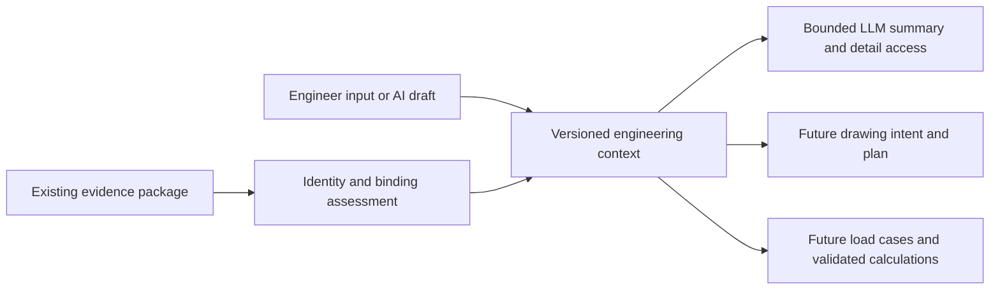

# Engineering context foundation — design draft

Prepared 2026-10-14 as a documentation-only continuation of the
[future roadmap](future-capabilities-roadmap-2026-10-14.md). Implementation was
subsequently authorized and the first offline slice is specified in
[Feature 016](../specs/016-engineering-context/spec.md), with
[usage instructions](../specs/016-engineering-context/quickstart.md).
This design still describes later structures beyond that slice. Native selection,
cross-extraction rebinding and unsaved-state attestation remain workstation gates;
broader load cases, drawing writers and structural calculations remain later work.

The subsequent [native-entry slice](../specs/016-engineering-context/native-entry.md)
implements saved-evidence preparation, pane inputs/confirmation and read-only selection
prefill. Offline tests cover these surfaces; workstation calibration and current-model
attestation remain open. Selection never supplies approval or source-freshness proof.

## First structure to build when authorised

Use a versioned engineering-context artifact that references the existing extracted
evidence. It holds engineer inputs and intent; the evidence package continues to
hold what was actually extracted. Keep the first increment small: a requirement
and one typed applied force attached to a component or face.



Reuse the current component tree, reference service, questions and tool boundary.
A separate database, graph framework, workflow engine or new pane tab is not needed
for this first milestone. The context artifact is a saved record with explicit
relationships and dependencies.

## Minimal record structure

| Record | Minimum responsibility |
|---|---|
| Context header | Schema version, stable context ID, revision, predecessor revision, content digest and timestamps. |
| Evidence baseline | Package ID/digest, root document/configuration, extractor/schema versions and known source/state attestation. |
| Target anchor | Stable context-local anchor ID, owning document/configuration and exact occurrence when applicable; available package-local entity IDs, native references/scopes and geometry. Missing handles remain absent for unresolved drafts. |
| Frame | Frame ID, root part/document, assembly or component owner, origin/convention, units, transform and its source/dependency fingerprint. |
| Engineering input | Stable record ID/revision, typed requirement or load, targets, values/units, provenance per input, assumptions and explicit unknowns. |
| Confirmation receipt | Immutable engineer decision naming the exact input revision, content digest and relevant dependency digest shown; actor/time and optional superseded receipt. |
| Binding receipt | Observation of the target against a particular source/configuration/occurrence, verification state, fingerprints and time. It neither confirms intent nor authorises a write. |
| Output dependency record (later/optional) | For persisted plans/calculations/generated outputs: type/ID, consumed inputs and binding receipts, method/rule/template versions, freshness and reasons. |

Package/file digests attest the exact saved evidence, not current native state.
Define a separate canonical input digest over the typed content presented for
confirmation: original values/units, anchor/frame, assumptions and provenance.
The dependency digest covers the relevant engineering conditions, including rule
versions. Exclude the confirmation receipt itself and mutable audit/storage
timestamps from those content digests; operating time/history remains typed input.
This avoids circular hashes and metadata-only changes becoming engineering edits.

Drawing intent and broader load cases extend these records later. A drawing intent
connects a view, dimension or note to a manufacturing requirement and real entities,
with datum/tolerance sources and open decisions. A load case adds operating
conditions, typed loads, application/distribution, confirmed supports/connections,
combinations and assumptions. Neither should be an unrestricted text blob.

Unknown, known and not-applicable values must be distinct. An unknown force or
support is not zero or absent. Provenance distinguishes extracted fact, engineer
input, catalogue fact, deterministic derivation and AI proposal. A derivation
names its inputs and method/version; AI confidence cannot substitute for a source.

## Identity and model binding

Current short entity IDs are handles within one package. They are not durable
identity across extraction. Current document IDs derive from normalised paths;
a move/copy needs an explicit continuity/relink decision. A matching basename,
part name or visually similar face does not establish identity.

Two instances of the same part require separate anchors: the same part face can
occur at different assembly positions and in different configurations. Keep part
ownership, reference scope and exact occurrence together. Resolve native references
against the document whose extension produced them. Reference bytes can change for
the same entity, so byte equality is not the identity test; the existing guarded
persistent-ID comparison/resolution service supplies the native observation when
available.

A selected face absent from the package may be saved as an unresolved draft. The
record must not invent a face ID or count engineer confirmation as extracted
geometry. A later bounded selection/read contract is needed to admit missing
geometry. A capture illustrates the selection; it does not prove target identity
or load application.

The extraction reuse key and package index are useful lookup/cache mechanisms,
not proof of engineering freshness. Relevant component placement, instance
configuration, entity geometry, material and engineering dependencies need their
own assessment. File bytes alone also do not establish the state of dirty/unsaved
CAD. Missing attestation produces an explicit unknown.

## Keep confirmation, binding and freshness separate

| Axis | Proposed states | Meaning |
|---|---|---|
| Engineering input | draft, confirmed input, needs review, rejected | What the engineer decided about a particular revision. |
| Binding | not verified, verified, unresolved, mismatch | What evidence establishes about the target in the assessed model state. |
| Output freshness | current, stale, cannot establish | Whether the dependencies used by an output still apply. |

Only an explicit engineer decision creates a confirmation receipt. An answered
free-text question, successful reference resolution, extraction refresh, save/reload
or LLM answer does not automatically confirm a typed input.

Changing magnitude, units as presented, target, frame, direction, distribution,
support, requirement, combination, factor, material source or governing policy
creates a new input revision. Preserve the old confirmation as history; it does
not cover the edited revision. A drawing-plan approval, generated-drawing
acceptance, structural acceptance and native execution permission are different
future decisions.

On refresh, retain the historical input and receipt, then assess binding and
relevant dependencies against the new baseline. Changed or unknown dependencies
make affected applicability need review and outputs stale/cannot establish. A new
package ID alone does not prove a change of intent or equivalence. If every relevant
dependency is deterministically verified unchanged, the original receipt may remain
applicable with a separate carry-forward observation; refresh never issues a new
confirmation. The first implementation should require review when that proof is
incomplete. Do not silently rebind split/merged topology to a similar entity.

Opening the artifact without SOLIDWORKS can display historical evidence and
confirmation. It cannot certify the currently open model. Future execution requires
current binding checks. Unrelated appended evidence need not invalidate every
record once reliable dependency-specific fingerprints exist; initially use
conservative broader invalidation.

## Quantities and coordinate frames

Use distinct engineering quantities for force, moment, pressure, mass,
acceleration and later load types. Preserve original value/unit alongside canonical
values computed by validated code using the existing shared unit registry. The
current length-only `Quantity` and exposed length/angle converters are not a load
contract. The first increment needs only its explicitly supported force quantity.

A force needs an application point/region, total-versus-distributed meaning, signed
direction and declared frame. A moment also needs its reference origin. Component-local
and assembly-global loads are different intentions when a component moves.

Reused component transforms are root-relative row-major 4×4 matrices with translations
in metres. Points include translation; direction/force vectors do not. Existing
normalised-axis helpers cannot be used to transform a force vector's magnitude.
Unknown frames, zero/unknown directions or unsupported scaled/reflected transforms
remain unresolved until the relevant semantics are specified and validated.

A fixed CAD component is not automatically a structural support, and a mate does
not prove a force path. Confirmed input can acknowledge missing engineering data;
that does not make the case complete or eligible for a calculation. Context stores
inputs and links to separate calculation evidence. The existing `Calculation`
record is a provenance pattern to reuse; its current length/angle/string inputs
are not already a structural-quantity contract. Calculation methods must later
consume immutable applicable inputs and return their own assumptions, limitations,
method version and results. Storage and summaries perform no structural analysis.

## Persistence and access boundaries

Proposed artifacts live in the private run/context area, not beside source CAD.
A runtime `engineering-context.json` could identify the current context revision,
with immutable revision records and confirmation history behind it. Define atomic
publication and an expected-head revision check: reject stale concurrent edits
rather than silently merging engineering decisions. Unsupported/malformed versions
must not overwrite an existing valid artifact. Restoration of an old revision does
not resurrect its applicability to a newer model.

The review run would inject matching context into the existing `ToolContext`.
The LLM would use context/record IDs for read-only detail access; it does not select
arbitrary filesystem paths or create confirmations. A deterministic bounded summary
names baseline, confirmed/draft/unknown/stale counts, short anchors and omission
counts. Bounded detail is available through the recorded tool boundary. Native
reference bytes and private paths stay behind the tools; engineering text is data,
not executable instructions. Existing drawing briefs remain evidence coverage,
not approved drawing plans.

## Proposed integration layout

The offline models, binding, store, brief and recorded read tools below are implemented
in Feature 016, with `workflow.py` and `cli.py` providing operator entry/confirmation.
The extractor's native selection/binding adapter remains prospective.

```text
reviewer/src/swreview/engineering_context/
    models.py       typed records, provenance, revisions and decision contracts
    binding.py      evidence/occurrence matching and dependency assessment
    store.py        artifact validation, revision history and atomic publication
    brief.py        deterministic bounded projections

reviewer/src/swreview/units.py
                    shared conversion registry, extended only for admitted quantities
reviewer/src/swreview/tools/engineering_context.py
                    recorded read-only access by context/record ID
extractor/SwReview.Extractor/EngineeringContext/
                    later bounded native selection/binding adapter
```

Keep native identity/reads in the extractor and engineering records/persistence in
the reviewer. The future native adapter must preserve the source document, active
configuration, focus/selection contract and read-only guard. Reading the engineer’s selection must not change it; any later Show/zoom remains
a separate action.

Existing reuse points:
[IR models](../reviewer/src/swreview/ir/models.py),
[reference service](../extractor/SwReview.Extractor/PersistRefs/PersistRefService.cs),
[document IDs](../extractor/SwReview.Extractor/Ids/DocumentIds.cs),
[package index](../extractor/SwReview.Extractor/Dump/PackageIndex.cs),
[reuse key](../extractor/SwReview.Extractor/Dump/ReuseKey.cs),
[transforms](../extractor/SwReview.Extractor/Geometry/SwTransform.cs),
[units](../reviewer/src/swreview/units.py),
[tool context](../reviewer/src/swreview/tools/context.py),
[questions/answers](../reviewer/src/swreview/tools/session.py),
[drawing brief](../reviewer/src/swreview/drawings/brief.py),
[calculation record](../reviewer/src/swreview/findings.py).

## First milestone and future acceptance cases

The first end-to-end milestone is: select a component/face → attach a requirement
or typed force → inspect target, values, frame and provenance → confirm the exact
revision → save/reload → assess a refreshed model → expose the honest context to
the LLM. It creates no drawing, computes no reaction/stress and authors no study.

The future specification should require these acceptance cases:

1. Exact revision, units, target, frame and confirmation history survive reload;
   malformed/unsupported records cannot replace the last valid artifact.
2. Repeated instances and swapped referenced configurations stay distinct; a load
   confirmed on one instance cannot appear confirmed on another.
3. Nested transforms apply once; point/vector treatment is correct and force
   magnitude is retained under supported rotations. Wrong dimension/unit kinds fail.
4. Missing faces, unresolved references, suppressed/unloaded targets, ambiguous
   selection, topology changes, dirty models and path changes stay explicit.
5. Editing quantity, units, frame, target, support or applicable policy requires a
   new confirmation; refresh/save alone never manufactures it.
6. Changed relevant dependencies invalidate affected inputs/outputs; proven unchanged
   dependencies preserve only the applicability of the original historical receipt.
7. Concurrent edits and old-revision restoration cannot revive stale decisions.
8. Deterministic summaries respect bounds, count omissions, expose unknown/stale
   states and exclude private paths/native references.
9. Offline fictional cases validate lifecycle rules; actual selection/reference
   behaviour is later checked on the separate SOLIDWORKS workstation.

When implementation is authorised, sequence the work: formalise the narrow contract
and examples; implement offline records/store/binding with test-first failures;
add existing-tool summaries/retrieval; add the bounded native adapter and workstation
checks; then validate the selected-entity round trip. Drawing plans, broader load
cases, calculation libraries and Simulation authoring remain later increments.
No new feature number, guard exception, scope amendment or native enablement is
assigned by this design draft.
